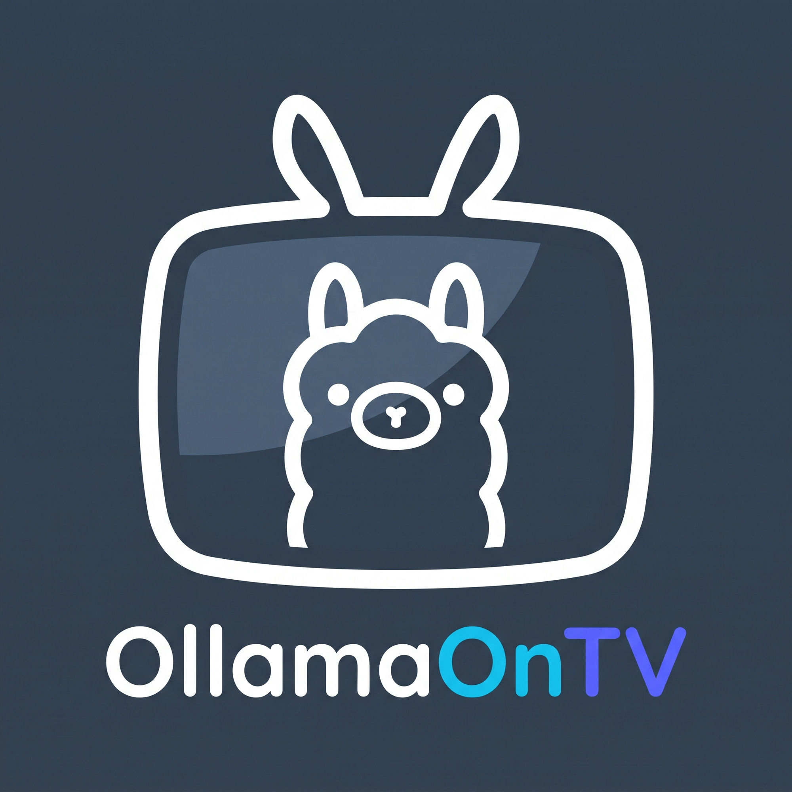
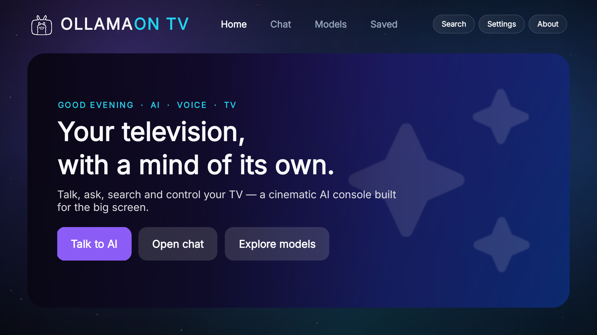
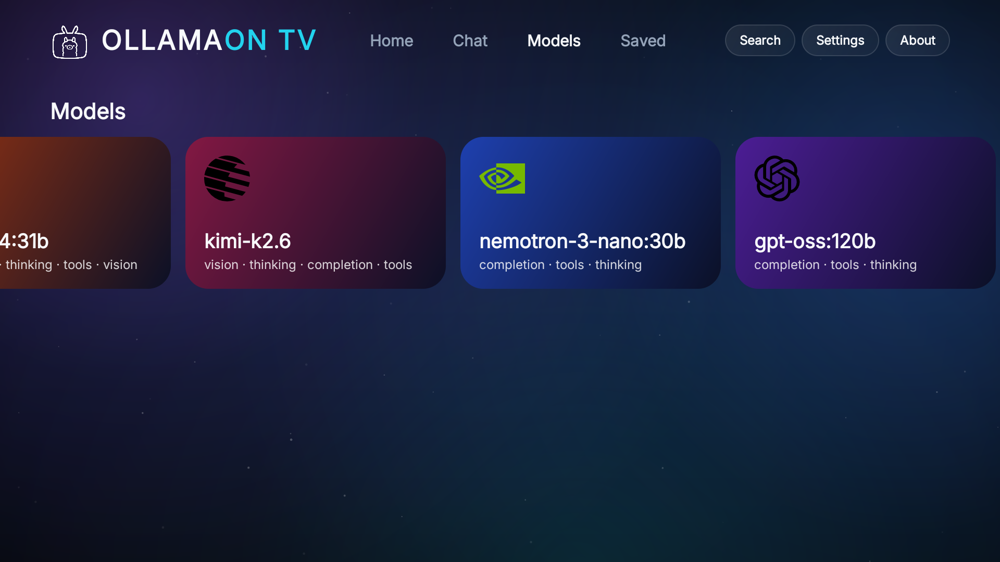
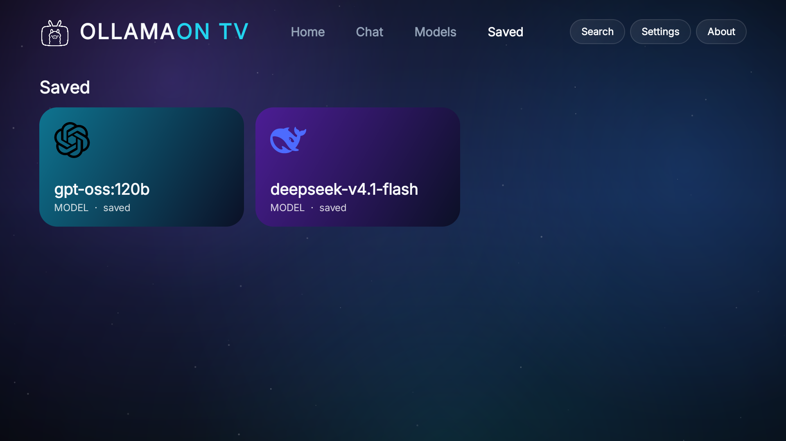
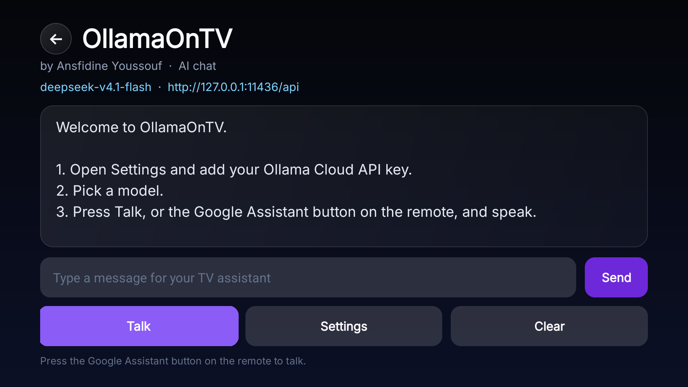
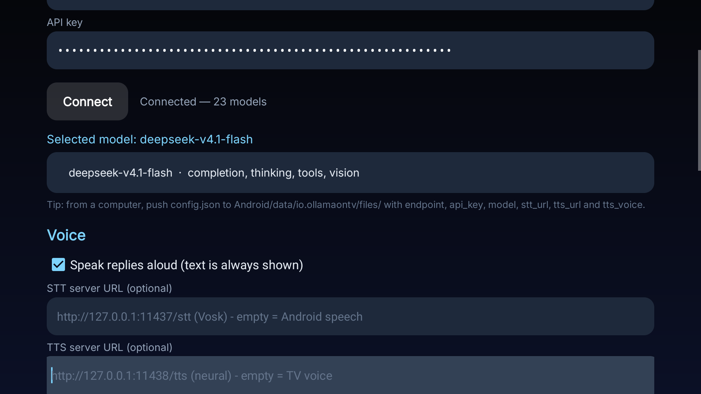
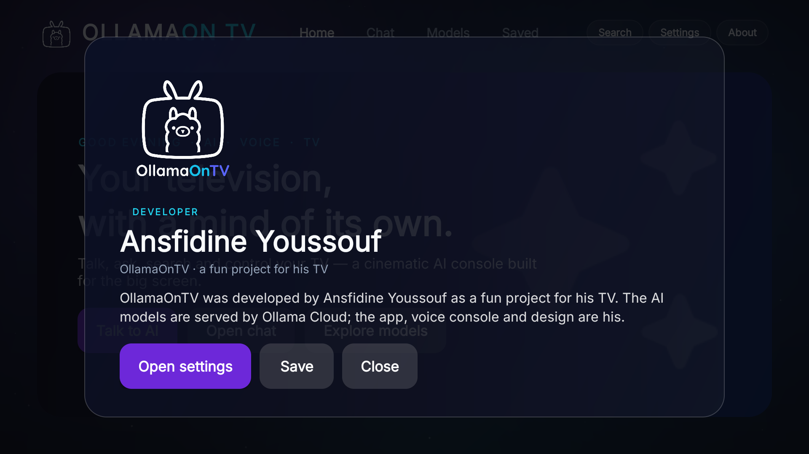
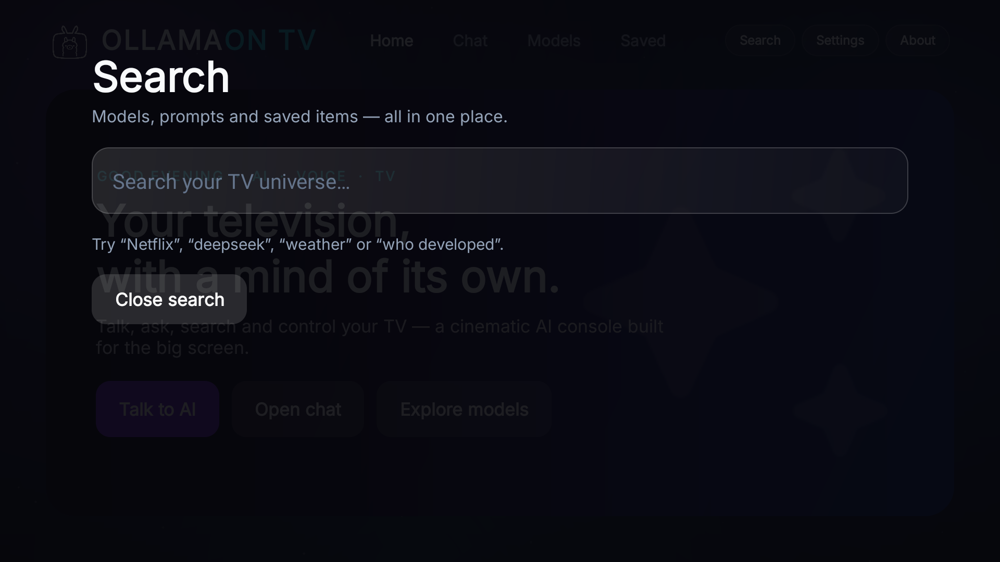

# OllamaOnTV



| Home | Models |
| --- | --- |
|  |  |
| **Saved** | **Chat** |
|  |  |
| **Settings** | **About** |
|  |  |
| **Search** | |
|  | |

A cinematic, voice-first AI console for Android TV / projector, developed by **Ansfidine
Youssouf** as a fun project for his TV (built and tested on an Anker Nebula Capsule 3 Laser,
Android 14). Press the Google Assistant button on the remote, speak,
and the answer is shown on screen and spoken aloud. It can also open apps, press remote keys,
set the volume, open TV settings, and search YouTube through Ollama tool calling.

Free and open source pieces only: the app and relay are plain Java/Python; speech recognition
and text-to-speech use the TV's built-in Google services; TV control uses the TV's own ADB.
Ollama Cloud has a free tier (check ollama.com/pricing for current limits).

## What was verified on this projector

- Two built-in microphones (`AudioFlinger`: mic count 2, built-in mic). The Anker remote has
  `HasMic: false`, so the projector's mics are what listen.
- Google TV speech recognition (`com.google.android.katniss`) and Google TTS are installed.
- The Assistant role can be assigned to another app with ADB. `KEYCODE_ASSIST` then launches
  OllamaOnTV instead of Google Assistant.
- The accessibility service is bound and has `CAPABILITY_CAN_REQUEST_FILTER_KEY_EVENTS`.
- Ollama Cloud `/api/tags` and `/api/chat` work with an API key, including tool calls.
- The TV cannot reach `ollama.com` directly on the tested network (likely filtering). The app
  therefore supports a LAN relay (below) that forwards to Ollama Cloud from a computer that can
  reach it. On an unrestricted network, use `https://ollama.com/api` directly with the key.
- TV control commands (`am start`, `input keyevent`, `cmd media_session volume`) work over the
  TV's local ADB. The app asks for its own ADB authorization once.
- Voice end to end: pressing the Assistant button opened OllamaOnTV, the built-in mics
  recognized "hello", and the cloud reply was shown and spoken. Google's recognizer can time
  out if you speak late; Settings -> Test recorder records a WAV and shows the mic peak.
- The TV's NekoBox VPN (tun0 172.19.0.1) intercepted LAN and DNS, so the LAN relay failed. The
  working setup tunnels the relay over ADB: the TV calls 127.0.0.1:11436, `adb reverse` forwards
  it to the Mac relay, and the TV VPN can stay on.

## Layout

```
OllamaOnTV/
  AndroidManifest.xml
  build.sh                  aapt2 + javac + d8 + apksigner; no Gradle
  src/io/ollamaontv/
    MainActivity.java       chat UI, Talk button, settings
    AssistActivity.java     voice screen; launched by the Assistant button
    SettingsActivity.java   endpoint, API key, model list, tests, prompt
    KeyService.java         accessibility fallback for the assistant/voice key
    Assistant.java          system prompt, Ollama chat, tool loop
    OllamaClient.java       /api/tags and /api/chat
    TvControl.java          launch apps, keys, volume, settings, YouTube search
    Adb.java                local ADB client (adapted from Free My TV, MIT)
    Speech.java             SpeechRecognizer wrapper
    Speaker.java            TextToSpeech wrapper
    Prefs.java, ConfigIO.java, UiKit.java, App.java
  relay/ollama_relay.py     optional LAN relay to https://ollama.com
```

## Build and install

```bash
./build.sh
adb connect <TV-IP>:5555
adb install -r OllamaOnTV.apk
adb shell pm grant io.ollamaontv android.permission.RECORD_AUDIO
```

The TV must have USB debugging / wireless debugging on and port 5555 reachable.

## Make it handle the Assistant button

The clean way (used here) is to give OllamaOnTV the Android Assistant role:

```bash
adb shell cmd role set-bypassing-role-qualification true
adb shell cmd role add-role-holder android.app.role.ASSISTANT io.ollamaontv
```

To restore Google Assistant:

```bash
adb shell cmd role remove-role-holder android.app.role.ASSISTANT io.ollamaontv
adb shell cmd role add-role-holder android.app.role.ASSISTANT com.google.android.katniss
```

The accessibility service is a fallback if the remote sends a voice key that the role does not
receive. Enable it in the TV's accessibility settings, or:

```bash
adb shell settings put secure enabled_accessibility_services io.ollamaontv/io.ollamaontv.KeyService
adb shell settings put secure accessibility_enabled 1
```

It only filters the assistant/voice/search keys and never reads window content.

## Configure

In the app: **Settings** → endpoint, API key, **Load models**, pick a model.

- Cloud directly: endpoint `https://ollama.com/api`, paste an API key from
  <https://ollama.com/settings/keys>. Works only where the TV can reach ollama.com.
- Local Ollama: endpoint `http://<computer-ip>:11434/api` (start Ollama with
  `OLLAMA_HOST=0.0.0.0:11434 ollama serve`).
- LAN relay (for blocked networks): run the relay on a computer that can reach Ollama Cloud,
  then use `http://<computer-ip>:11436/api` on the TV and leave the key empty. If the TV uses a
  VPN, use the ADB reverse tunnel below instead.
- ADB reverse tunnel (recommended here; works with the TV VPN on):
  `adb -s <TV-IP>:5555 reverse tcp:11436 tcp:11436`,
  `adb -s <TV-IP>:5555 reverse tcp:11437 tcp:11437` and
  `adb -s <TV-IP>:5555 reverse tcp:11438 tcp:11438`, then endpoint
  `http://127.0.0.1:11436/api` and STT URL `http://127.0.0.1:11437/stt`. This bypasses LAN/VPN
  issues and the Mac firewall. `tools/connect.sh` sets both.

The model list is public on Ollama Cloud, but chat needs a key. Models with the `tools`
capability can control the TV.

You can also push settings from a computer (the file is imported and deleted at app start):

```bash
adb push config.json /sdcard/Android/data/io.ollamaontv/files/config.json
```

```json
{"endpoint":"http://192.168.1.20:11436/api","model":"gpt-oss:20b","speak":true}
```

Never commit a real `config.json` or API key.

## Relay for blocked networks

```bash
printf '%s' 'YOUR_OLLAMA_API_KEY' > ~/.ollama_cloud_key
chmod 600 ~/.ollama_cloud_key
python3 relay/ollama_relay.py 11436
```

The relay listens on all interfaces, proxies only `/api/*`, and injects the key. Keep it on a
trusted network. The TV endpoint is `http://<computer-ip>:11436/api` and the app's API key can
stay empty. To run it in the background:

```bash
nohup python3 relay/ollama_relay.py 11436 > /tmp/ollama_relay.log 2>&1 &
```

On macOS, LaunchAgents keep the relay and Vosk STT running. Because launchd cannot read the
Desktop, the runtime copies, model and key live in `~/Library/Application Support/OllamaOnTV/`;
the plists are `~/Library/LaunchAgents/io.ollamaontv.relay.plist`,
`io.ollamaontv.stt.plist` and `io.ollamaontv.tts.plist`. Load them with:

```bash
launchctl bootstrap gui/$(id -u) ~/Library/LaunchAgents/io.ollamaontv.relay.plist
```

Unload with `launchctl bootout gui/$(id -u)/io.ollamaontv.relay`. The relay injects the key,
so the TV app's key can be empty.

If the computer's IP changes, update the endpoint in Settings. For the reverse tunnel, run
`tools/connect.sh <TV-IP>` after a TV reboot or an ADB restart; the tunnel does not survive
those.

## TV control

The first time a tool needs ADB, the TV shows **Allow USB debugging?** for the app's RSA key.
Tick **Always allow from this computer** and choose **Allow**. The app keeps its key in its
private storage. It connects to `127.0.0.1:5555`, so it does not expose ADB to the network.

Tools: `launch_app`, `press_key`, `set_volume`, `open_settings`, `search_youtube`. Add more in
`Assistant.tools()` and `TvControl.execute()`. `set_volume` uses
`cmd media_session volume --stream 3 --set N` (verified).

If port 5555 is closed after a TV reboot, enable wireless debugging or run
`adb tcpip 5555` from a computer again.

## Voice and text

- With an STT URL configured, the Assistant button launches `AssistActivity`, records 6 seconds
  from the projector's built-in mics, sends the WAV to the local Vosk server, sends the text to
  Ollama, shows the reply, and speaks it with TTS. This path does not use Google speech and works
  on a VPN/China network.
- Replies use the TV's built-in Google voice by default (leave the TTS URL empty). Set a TTS URL
  to use a neural Edge TTS voice instead; the text is then sent to Microsoft's Edge TTS service.
  The newer `en-US-AvaMultilingualNeural` and `en-US-EmmaMultilingualNeural` voices are more
  natural than the older default `en-US-AriaNeural`; also try `en-US-GuyNeural` (male),
  `en-GB-SoniaNeural` (British) or `zh-CN-XiaoxiaoNeural` (Chinese). `tts/tts_server.py` runs on
  11438 and is reached through `adb reverse tcp:11438 tcp:11438` at
  `http://127.0.0.1:11438/tts`. Without an STT URL it falls back to the TV's `SpeechRecognizer`.
- The Vosk server is `stt/vosk_server.py` (English small model). It listens on 11437; the TV
  reaches it through `adb reverse tcp:11437 tcp:11437` at `http://127.0.0.1:11437/stt`.
  Settings -> STT server URL. The model sits in
  `~/Library/Application Support/OllamaOnTV/vosk-model-small-en-us`; add the Chinese model and
  change `VOSK_MODEL` for Chinese.
- The main screen has the same chat plus a text field; both text and voice are always shown.
  Speech can be turned off in Settings. The TV's embedded Google TTS voice works offline.
- Microphone diagnostics: Settings -> Test recorder records a 5-second WAV and shows peak/RMS;
  Settings -> Test microphone uses the TV's Google recognizer.
- **Test microphone** in Settings runs recognition without calling the model.
- If speech recognition is unavailable, the app still works as a text assistant. A future
  fallback can use Vosk/Whisper on the TV or a Whisper server on the LAN.

## Troubleshooting the connection

- If the cloud cannot be reached and a VPN is active, the app says so and asks you to switch
  to another VPN server or turn the VPN off for OllamaOnTV. Settings also has **Test connection**.
- If the endpoint is a local relay/Ollama, the app asks you to start the relay and run
  `tools/connect.sh` (or switch to the cloud endpoint in Settings).
- The Home Models row shows a **Couldn't load models** card that retries when selected.

## Privacy and security

- The API key is stored in the relay's key file (mode 600) and in
  `~/Library/Application Support/OllamaOnTV/key` for the LaunchAgent. The TV app's key is empty
  in this setup. It is never logged or sent anywhere except the configured endpoint. Rotate it
  if it has been shared.
- The relay is plain HTTP on the LAN (it forwards to HTTPS). Use it only on a trusted network.
- The ADB client talks to `127.0.0.1` only. Granting the Assistant role and accessibility
  service is reversible (commands above).
- Speech audio is handled by the TV's Google recognition service, not by this app.

## Built with

- **Ollama Cloud** — models, chat and web search. The app defaults to `deepseek-v4.1-flash`.
- **Microsoft Edge TTS** — the neural voice (default `en-US-AriaNeural`).
- **Vosk** — local speech-to-text with the large English graph model.
- **Free My TV's ADB client** (MIT) — local TV control, adapted from
  [simbasjungles/free-my-tv](https://github.com/simbasjungles/free-my-tv).
- **Inter** (SIL OFL 1.1) and **Material Symbols** (Apache 2.0).
- Android SDK / JDK, macOS LaunchAgents, and ADB reverse tunnels for the relay, STT and TTS.
- UI/UX, app code and the cinematic design — **Ansfidine Youssouf**.

The Android app has no third-party UI framework: it is plain Java, Canvas and standard views,
built with `aapt2 + javac + d8 + apksigner` (no Gradle). The Mac side is plain Python.

## No API key included

This repository and the release APK contain **no Ollama API key**. The relay reads the user's
key from a private file (`~/.ollama_cloud_key` or
`~/Library/Application Support/OllamaOnTV/key`); the TV app's API-key field is user-supplied and
empty by default. `config.properties`, `config.json`, `*.keystore`, the generated APK and the
key file are gitignored. Use your own key from
[ollama.com/settings/keys](https://ollama.com/settings/keys) and rotate it if it has been shared.

## Developer

OllamaOnTV was developed by **Ansfidine Youssouf** as a fun project for his TV. Every model in
the app is told this in its system prompt, so asking who developed the app answers with his
name.

## Credits

- ADB client adapted from [Free My TV](https://github.com/simbasjungles/free-my-tv) (MIT).
- [Ollama](https://ollama.com) API.
- [Edge TTS](https://github.com/rany2/edge-tts) for the neural voice (free Microsoft Edge voices).
- The UI icons are drawn in `res/drawable/ic_launcher.xml`.
